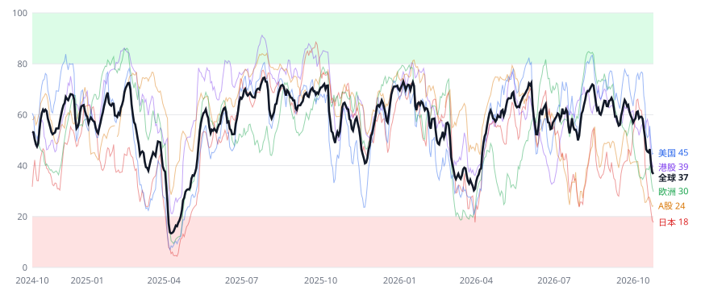

# 全球市场恐慌指数

每天自动更新的 0–100 恐慌指数，覆盖美国、欧洲、日本、A股、港股。0 = 极度贪婪，100 = 极度恐慌。仅供个人判断市场情绪参考，不构成投资建议。

<!-- latest:start -->
**最新读数（2026-10-23 收盘）**

| 区域 | 恐慌指数 | 状态 | 5日变化 | 仓位信号 |
| --- | --- | --- | --- | --- |
| 全球 | 61 | 恐慌 | +8.3 | 恐慌升温，减仓 |
| 美国 | 53 | 中性 | +6.8 | 正常 |
| 欧洲 | 68 | 恐慌 | +7.4 | 恐慌升温，减仓 |
| 日本 | 86 | 极度恐慌 | +16.1 | 恐慌升温，减仓 |
| A股 | 71 | 恐慌 | +2.3 | 恐慌升温，减仓 |
| 港股 | 55 | 中性 | +14.3 | 正常 |


<!-- latest:end -->

## 怎么算的

1. 每个区域 4–5 个成分：波动率指数、实际波动率、回撤、偏离均线、高收益债相对国债表现、避险资产等（完整清单见 `fearindex/config.py`）。
2. 每个成分换算成过去 1260 个交易日（约 5 年）里的分位数 × 100，数值越高越恐慌。
3. 区域分 = 成分加权平均；全球分 = 区域按市值大致加权（美 45%、欧 20%、日 10%、A 15%、港 10%）× 90% + 全球公共成分（美债波动率、黄金、美债避险）× 10%。
4. 最终做 3 日指数平滑。
5. 仓位信号：某区域分数 ≥ 60 且高于 20 个交易日前，提示“恐慌升温，减仓”（回测中半仓执行）。

## 怎么用

回测（2001–2026）显示，这个指数和下跌基本同步，不是提前预警：通常跌了 5–13% 之后才升到 70。高恐慌之后的走势分两种：2019 年以前多为继续下跌，2019 年以后多为快速反弹，所以单纯“越恐慌越加仓”并不稳。更可靠的用法是：恐慌还在升温时降低仓位，等分数从高位回落、仓位信号恢复正常后再加回。

| 分数 | 状态 |
| --- | --- |
| 0–20 | 极度贪婪 |
| 20–40 | 贪婪 |
| 40–60 | 中性 |
| 60–80 | 恐慌 |
| 80–100 | 极度恐慌 |

## 文件

- `data/index.csv`：每日全球及各区域分数
- `data/components.csv`：各成分分位得分；`data/components_raw.csv`：成分原始值
- `data/latest.json`：最新读数与数据健康状态
- `docs/index.html`：交互式仪表盘；`docs/chart.svg`：近两年走势图
- `reports/backtest.md`：回测报告

## 运行

```bash
pip install -r requirements.txt
python scripts/run_daily.py          # 增量更新（首次会自动拉全部历史）
python scripts/run_backtest.py       # 生成回测报告
python -m pytest -q                  # 单元测试（合成数据）
```

GitHub Actions 每个交易日北京时间 07:30 自动运行 `daily-update`，失败时 GitHub 会发邮件提醒。

数据源：Yahoo Finance、AkShare（东方财富 / 腾讯 / 新浪指数行情、金十融资余额、期权论坛 QVIX），A股行情按顺序自动切换备用源。
